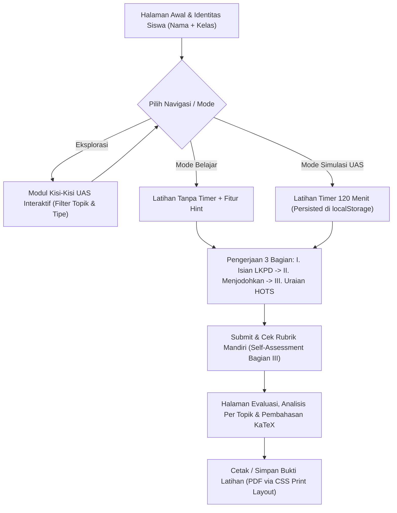

# ROADMAP Pengembangan Web Kisi-Kisi & Latihan UAS Matematika Tingkat Lanjut (Kelas XI)

Dokumen ini merupakan peta jalan (*roadmap*) implementasi berdasarkan [prd_web_latihan_kisi_kisi_uas_matematika_tingkat_lanjut_xi.md](./prd_web_latihan_kisi_kisi_uas_matematika_tingkat_lanjut_xi.md). Pengembangan dibagi menjadi **5 Fase Utama (MVP)** dan **1 Fase Pengembangan Lanjutan (Opsional)** dengan pendekatan *Single-File Web Application* (`HTML5 + Tailwind CSS + Vanilla JS + KaTeX`).

---

## Ringkasan Analisis & Pemetaan Bobot Skor

Berdasarkan spesifikasi PRD, terdapat **20 butir soal** dengan total waktu **120 menit** dan **100 poin**. Berikut pemetaan distribusi butir dan bobot poin maksimal per topik yang menjadi dasar kalkulasi skor dan analitik penguasaan materi:

| Topik Materi | Proporsi Butir | Bagian I (Isian @2 pt) | Bagian II (Menjodohkan @3 pt) | Bagian III (Uraian HOTS) | Total Poin Topik |
| :--- | :---: | :---: | :---: | :---: | :---: |
| **Polinomial** | 6 Soal (30%) | No. 1, 2, 3 (6 pt) | No. 11, 12 (6 pt) | No. 16 (10 pt) | **22 Poin** |
| **Operasi Matriks** | 10 Soal (50%) | No. 4, 5, 6, 7, 8 (10 pt) | No. 13, 14 (6 pt) | No. 17 (14 pt), No. 18 (11 pt), No. 20 (18 pt) | **59 Poin** |
| **Translasi** | 4 Soal (20%) | No. 9, 10 (4 pt) | No. 15 (3 pt) | No. 19 (12 pt) | **19 Poin** |
| **Total Keseluruhan** | **20 Soal (100%)** | **10 Soal (20 pt)** | **5 Soal (15 pt)** | **5 Soal (65 pt)** | **100 Poin** |

---

## Arsitektur Alur Sistem

---

## Fase 1: Perancangan Konten Matematis & Bank Soal Isomorfik
**Tujuan:** Menyusun dan memvalidasi seluruh naskah soal paralel (angka bulat, matriks berdeterminan $\pm 1$, pengecoh terukur, petunjuk/*hint*, pembahasan langkah demi langkah, dan rubrik penilaian mandiri) sebelum masuk ke kode.

- [x] **1.1. Penyusunan Data Kisi-Kisi (20 Indikator)**
  - Menyusun struktur data JSON untuk 20 nomor soal mencakup: Nomor, Topik (`Polinomial`, `Matriks`, `Translasi`), Level Kognitif (`L1`, `L2`, `L3`), Indikator Soal, Bentuk Soal, Bobot Poin, dan Estimasi Waktu.
- [x] **1.2. Perancangan Soal Bagian I — Isian Singkat Model LKPD (No. 1–10 | 20 Poin)**
  - **Kartu Narasi 1 (No. 1–3 | Polinomial):** Konteks *Akuarium Kaca / Kolam Ikan* dengan dimensi $p(x), l(x), t(x)$, ekspresi polinomial volume $V(x)$, dan evaluasi nilai $V(x)$ untuk $x$ tertentu.
  - **Kartu Narasi 2 (No. 4–8 | Operasi Matriks $2 \times 2$):** Konteks *Penjualan Roti Cokelat & Keju di 2 Gerai (Sabtu–Minggu)* mencakup penjumlahan, selisih, perkalian skalar, identifikasi ordo, dan perkalian matriks pendapatan.
  - **Kartu Narasi 3 (No. 9–10 | Translasi Titik):** Konteks *Pergerakan Robot Gudang / Kapal Nelayan* dengan dua translasi berurutan $T_1$ dan $T_2$.
  - Menetapkan daftar variasi kunci jawaban yang diterima (*accepted answers*) beserta petunjuk format input.
- [x] **1.3. Perancangan Soal Bagian II — Menjodohkan (No. 11–15 | 15 Poin)**
  - Menyusun 5 soal (No. 11–12 Teorema Sisa & Faktor, No. 13–14 Determinan & Kesamaan Matriks, No. 15 Translasi Garis $3x + y - 4 = 0$ oleh $T=(-2, 3)$).
  - Menyusun 7 opsi jawaban (`A`–`G`) dengan 5 jawaban benar dan 2 pengecoh (*distractor*) berbasis kesalahan konsep umum (salah tanda substitusi atau determinan).
- [x] **1.4. Perancangan Soal Bagian III — Uraian HOTS & Rubrik Mandiri (No. 16–20 | 65 Poin)**
  - **No. 16 (10 pt):** Polinomial derajat 3 habis dibagi $(x+1)$ atau $(x-2)$ dengan 3 akar bulat berbeda (Horner & pemfaktoran).
  - **No. 17 (14 pt):** SPLDV kontekstual (*Paket Katering / Sewa Lapangan*) diselesaikan dengan metode Invers Matriks atau Determinan Cramer.
  - **No. 18 (11 pt):** Persamaan matriks $A \cdot X = B$ dengan $\det(A) = \pm 1$ dan pembuktian sifat non-komutatif $A \cdot B \neq B \cdot A$.
  - **No. 19 (12 pt):** Komposisi translasi segitiga $PQR$ (*Lahan Parkir*), pembuktian invariansi luas bangun, dan translasi garis pedestrian $h$.
  - **No. 20 (18 pt):** Kriptografi/sandi matriks $3 \times 3$ dengan $\det(M) = \pm 1$ (pencarian determinan, matriks kofaktor, adjoin, invers $M^{-1}$, dan dekripsi pesan).
  - Memecah rubrik tiap soal menjadi *checklist item* bernilai poin parsial yang totalnya tepat **65 poin**.
- [x] **1.5. Penyusunan Hint & Pembahasan Lengkap**
  - Menulis 1 *hint* singkat per nomor (untuk Mode Belajar) dan pembahasan langkah demi langkah berformat LaTeX/KaTeX untuk seluruh 20 soal.

---

## Fase 2: Fondasi Aplikasi, UI Shell & Manajemen State
**Tujuan:** Membangun kerangka aplikasi *Single-File* (`index.html`), integrasi pustaka, penyimpanan `localStorage`, dan alur masuk identitas siswa.

- [x] **2.1. Setup Single-File HTML, Tailwind CSS & KaTeX**
  - Mengonfigurasi `index.html` dengan Tailwind CSS CDN, KaTeX CSS/JS + `auto-render` extension, serta konfigurasi tipografi dan warna ramah baca (*mobile-first*).
- [x] **2.2. Sistem State Management & Persistensi `localStorage`**
  - Membuat modul penyimpanan lokal (`kisi_uas_math_xi_state`) yang menyimpan:
    - Identitas (`nama`, `kelas`, `startedAt`, `completedAt`)
    - Mode latihan (`belajar` atau `simulasi`) & state timer (`remainingSeconds` / `targetEndTime`)
    - Jawaban siswa (`bagian1`, `bagian2`, `bagian3Text`, `bagian3Rubric`)
    - Status pengumpulan (`isSubmitted`)
  - Menyediakan tombol **Reset / Ganti Siswa** dengan dialog konfirmasi.
- [x] **2.3. Halaman Awal & Validasi Identitas Siswa**
  - Membuat form input **Nama Lengkap** (wajib, minimal 3 karakter) dan tombol pilihan **Kelas** khusus untuk **`XI-1`** dan **`XI-2`**.
  - Membuat kartu pemilihan **Mode Belajar** (tanpa batas waktu + tombol *Hint*) vs **Mode Simulasi UAS** (timer mundur 120 menit).
- [x] **2.4. Header Sticky & Navigasi Utama**
  - Menampilkan badge identitas siswa (`Nama — Kelas`), indikator mode aktif, timer mundur *real-time* (untuk Mode Simulasi), dan tab perpindahan cepat (**Kisi-Kisi**, **Bagian I**, **Bagian II**, **Bagian III**, **Hasil & Pembahasan**).

---

## Fase 3: Implementasi Modul Kisi-Kisi UAS Interaktif
**Tujuan:** Menyajikan peta materi dan bobot ujian secara visual dan transparan agar siswa dapat mengatur strategi belajar.

- [x] **3.1. Dashboard Ringkasan Kisi-Kisi**
  - Menampilkan kartu ringkasan: Total 20 Soal, Durasi 120 Menit, serta visualisasi proporsi topik (**Polinomial 30%**, **Operasi Matriks 50%**, **Translasi 20%**) dan rincian alokasi waktu per bagian ($25' + 20' + 75'$).
- [x] **3.2. Tabel Kisi-Kisi Interaktif dengan Filter**
  - Menampilkan tabel 20 indikator soal lengkap dengan dukungan *horizontal scroll* pada layar HP.
  - Membuat filter interaktif berdasarkan **Topik Materi** (`Semua`, `Polinomial`, `Operasi Matriks`, `Translasi`) dan **Bentuk Soal** (`Semua`, `Isian Singkat`, `Menjodohkan`, `Uraian HOTS`).

---

## Fase 4: Implementasi Modul Latihan Soal & Mesin Penilaian
**Tujuan:** Membangun antarmuka pengerjaan soal untuk ketiga bagian beserta logika validasi, normalisasi teks, dan *self-assessment*.

- [x] **4.1. Komponen Bagian I — Isian Singkat LKPD Interaktif (No. 1–10)**
  - Merender 3 kartu narasi kontekstual dengan *inline input* di dalam kalimat rumpang.
  - Mengimplementasikan fungsi `normalizeAnswer(input)`:
    - Menghapus spasi berlebih dan menyeragamkan huruf kecil (*case-insensitive*).
    - Menghapus titik pemisah ribuan pada angka (contoh: `650.000` $\rightarrow$ `650000`).
    - Menyeragamkan karakter minus Unicode (`−`, `–`, `—` $\rightarrow$ `-`) dan format koordinat/ordo.
- [x] **4.2. Komponen Bagian II — Menjodohkan Interaktif (No. 11–15)**
  - Menampilkan 5 soal di panel kiri dan 7 kartu pilihan `A`–`G` (dirender dengan KaTeX) di panel kanan.
  - Menyediakan pemilih pasangan jawaban (*dropdown* `A`–`G`) di tiap soal.
  - Mengimplementasikan deteksi duplikasi pilihan: menampilkan peringatan visual ringan (*soft warning badge*) apabila huruf yang sama dipilih pada lebih dari satu nomor.
- [x] **4.3. Komponen Bagian III — Uraian HOTS & Rubrik Mandiri (No. 16–20)**
  - Menampilkan 5 soal HOTS lengkap dengan kotak *textarea* per sub-soal (`a`, `b`, `c`) untuk mencatat langkah kerja siswa.
  - Menampilkan panel **Cek Rubrik Mandiri (Self-Assessment)** setelah siswa menekan tombol **Selesai & Kumpulkan**, di mana siswa mencentang langkah penyelesaian yang berhasil dikerjakan untuk menghitung skor Bagian III (maksimal 65 poin).
- [x] **4.4. Fitur Pendukung Pengerjaan (Hint, Timer & Navigasi Nomor)**
  - Tombol *Hint* per nomor yang hanya muncul pada **Mode Belajar**.
  - Logika *countdown timer* 120 menit pada **Mode Simulasi UAS** dengan peringatan saat sisa waktu 15 menit dan 5 menit, serta *auto-submit* ketika waktu habis.
  - Indikator progres pengerjaan (jumlah soal terjawab dari 20 soal).

---

## Fase 5: Halaman Evaluasi, Analisis Topik, Pembahasan & Cetak PDF
**Tujuan:** Memberikan umpan balik belajar yang komprehensif bagi siswa dan bukti pengerjaan yang siap dikumpulkan kepada guru.

- [x] **5.1. Kartu Skor & Analisis Penguasaan Per Topik**
  - Menghitung dan menampilkan:
    - **Skor Otomatis Bagian I** (0–20 poin)
    - **Skor Otomatis Bagian II** (0–15 poin)
    - **Skor Rubrik Mandiri Bagian III** (0–65 poin)
    - **Total Skor Akhir** (0–100 poin) & predikat kesiapan UAS.
  - Menampilkan grafik/bar persentase penguasaan untuk **Polinomial** (maks 22 pt), **Operasi Matriks** (maks 59 pt), dan **Translasi** (maks 19 pt), disertai rekomendasi topik yang perlu dipelajari ulang jika penguasaan $< 75\%$.
- [x] **5.2. Tampilan Pembahasan Langkah demi Langkah**
  - Menampilkan status Benar/Salah per nomor pada Bagian I & II (jawaban siswa vs kunci jawaban) serta pembahasan lengkap berformat KaTeX untuk nomor 1–20.
- [x] **5.3. Fitur Cetak / Simpan Bukti Latihan (PDF)**
  - Mengimplementasikan stylesheet `@media print` dan tombol **Cetak / Simpan PDF** (`window.print()`).
  - Mengatur tata letak cetak agar memuat header resmi bukti latihan, **Nama Lengkap**, **Kelas**, **Mode Latihan**, **Waktu Selesai**, **Tabel Ringkasan Skor & Analisis Topik**, serta **Rincian Jawaban Siswa** secara rapi di kertas A4 tanpa elemen navigasi yang mengganggu.

---

## Fase 6: Pengujian Kualitas (QA) & Pengembangan Lanjutan (Opsional)
**Tujuan:** Memastikan keakuratan matematis, kenyamanan tampilan di perangkat seluler, dan menyiapkan fitur ekspansi.

- [x] **6.1. Verifikasi & QA (Wajib Sebelum Rilis MVP)**
  - **Audit Rendering KaTeX:** Memastikan tidak ada rumus atau matriks $3 \times 3$ yang terpotong pada layar ponsel berukuran 360px–414px (*mobile-first check*).
  - **Audit Auto-Grading:** Menguji variasi input siswa (dengan/tanpa titik ribuan, spasi, variasi tanda minus) pada No. 1–10.
  - **Audit Persistensi & Print:** Menguji *refresh* halaman di tengah sesi latihan dan memeriksa hasil ekspor PDF melalui dialog `Print to PDF`.
- [ ] **6.2. Backlog Fase 2 (Pengembangan Lanjutan Opsional)**
  - **Integrasi Google Sheets / Google Forms Webhook:** Mengirimkan rekap Nama, Kelas, Skor Bagian I–III, dan Waktu Selesai secara otomatis ke *spreadsheet* guru saat siswa menyelesaikan latihan.
  - **Dynamic Problem Generator:** Mengacak koefisien polinomial, elemen matriks ($\det = \pm 1$), dan vektor translasi secara dinamis agar siswa dapat berlatih berulang kali dengan angka baru.

---

## Definisi Selesai (Definition of Done — MVP)
1. Siswa wajib mengisi **Nama Lengkap** dan **Kelas** sebelum memulai latihan, dan data bertahan meskipun halaman di-*refresh*.
2. Seluruh 20 indikator pada **Kisi-Kisi Interaktif** dan 20 soal pada **Latihan Paralel** tampil dengan notasi matematika **KaTeX** yang tajam dan responsif di HP maupun laptop.
3. Penilaian otomatis Bagian I & II, peringatan duplikasi Menjodohkan, dan kalkulasi rubrik mandiri Bagian III menghasilkan total skor akhir (0–100) serta persentase per topik yang akurat.
4. Tombol **Cetak / Simpan PDF** menghasilkan dokumen laporan hasil latihan yang bersih dan siap dikumpulkan ke guru.
